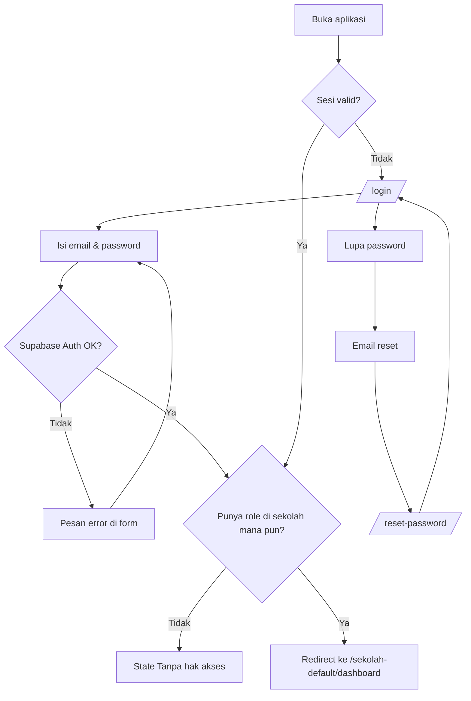
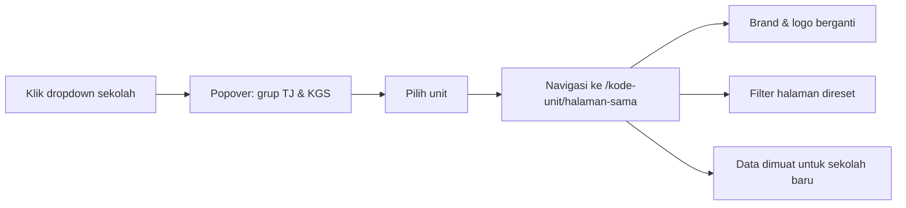
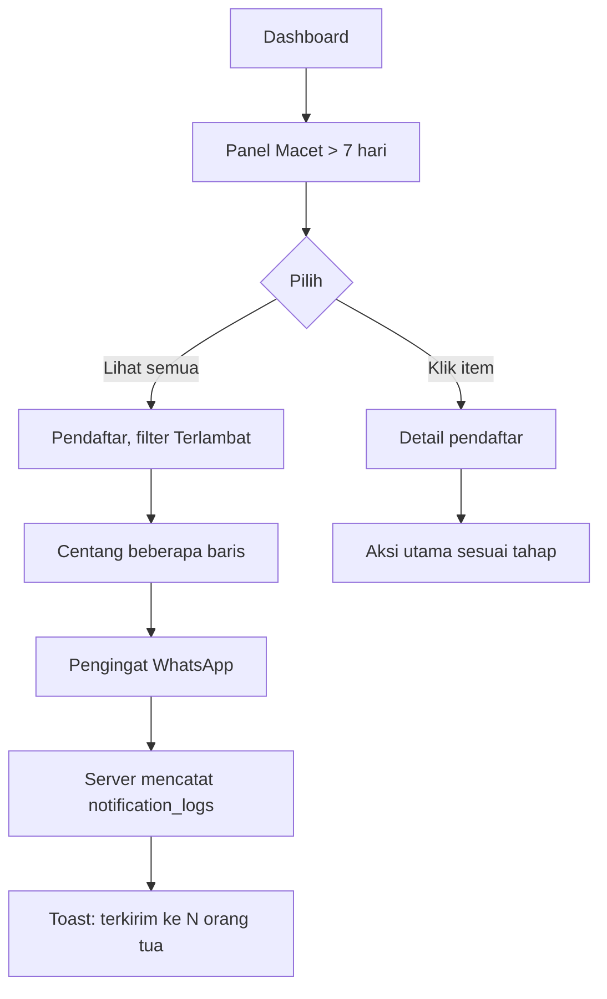
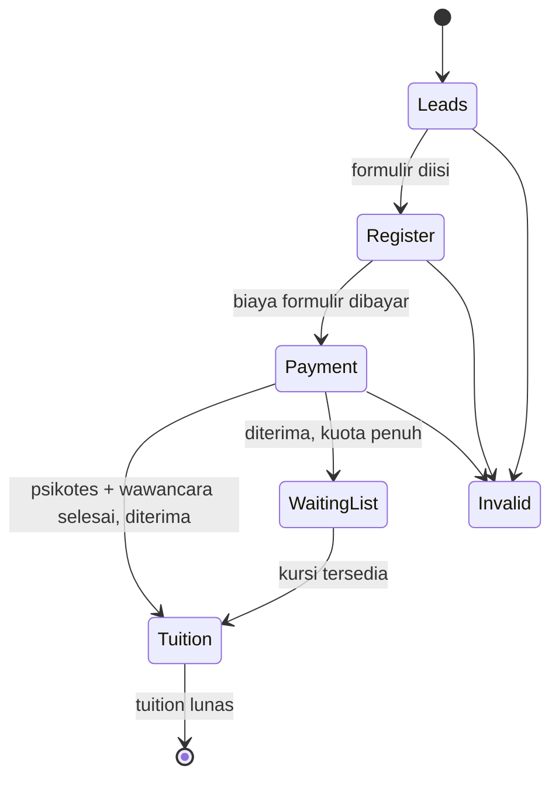
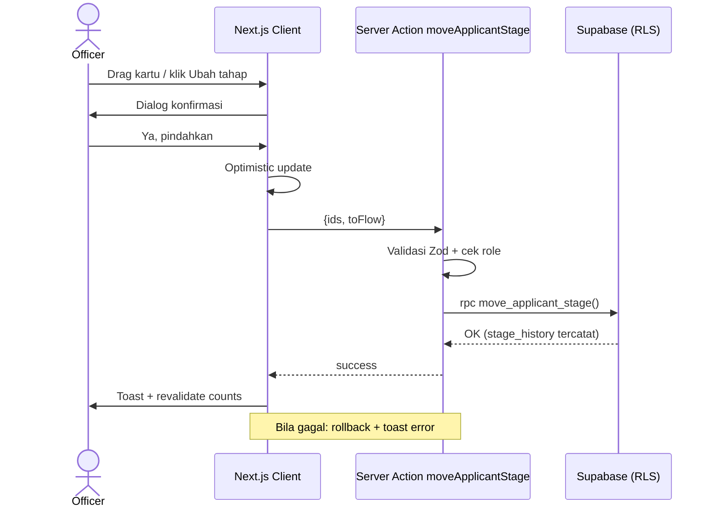
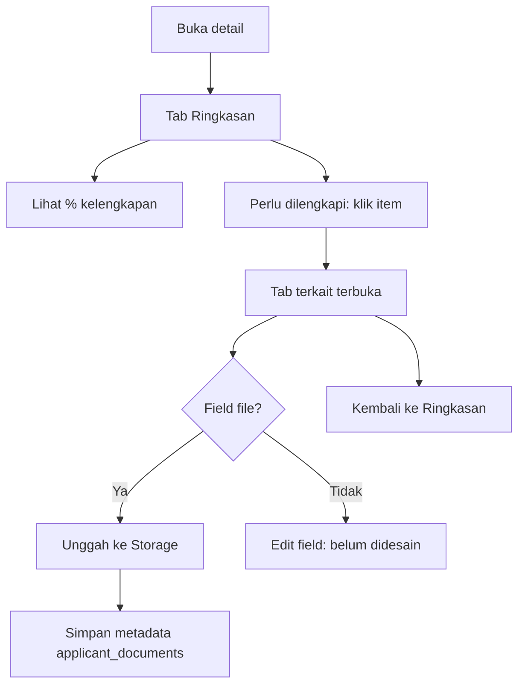
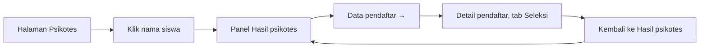
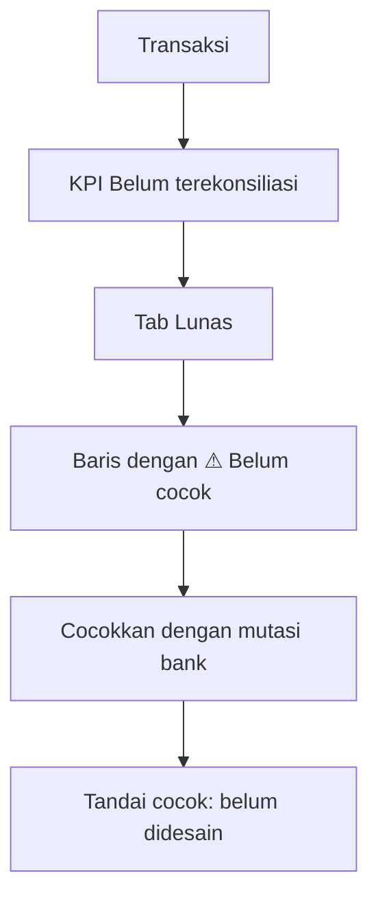
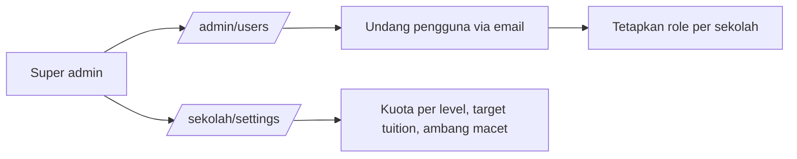

# 07 · User Flows

## 1. Autentikasi (belum didesain, REKOMENDASI)

## 2. Pindah sekolah

## 3. Menindaklanjuti pendaftar macet

## 4. Siklus tahap pendaftar

Catatan: prototipe mengizinkan pindah ke tahap **mana pun** lewat dialog (termasuk mundur). Aturan transisi yang sah adalah `DECISION REQUIRED` (lihat [15](15-BUSINESS-LOGIC.md#transisi-tahap)).

## 5. Ubah tahap (CRUD update)

## 6. Melengkapi data di detail

## 7. Psikotes → pendaftar → kembali

## 8. Keuangan: rekonsiliasi

## 9. Admin (belum didesain)

