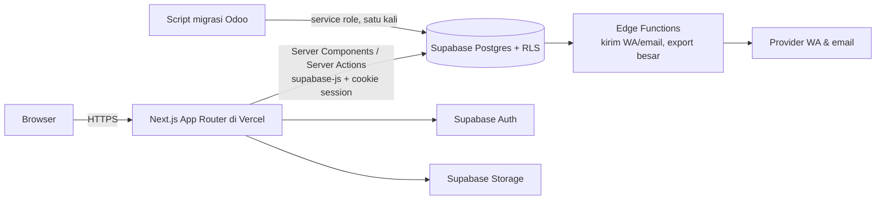

# 09 · Technical Architecture

## 1. Gambaran



## 2. Prinsip Next.js

| Topik | Keputusan |
|---|---|
| Default | **Server Components** untuk halaman & data fetching |
| Client Components | Hanya untuk interaksi: filter, tab, view toggle, seleksi, drawer, dnd, chart, tooltip, toast |
| Mutasi | **Server Actions** (form & aksi UI). **Route Handlers** untuk export file, auth callback, webhook |
| Data fetching | Supabase server client per request (cookie). Tidak ada fetch langsung ke Supabase dari komponen kecuali realtime (opsional) |
| URL state | `searchParams` dibaca di Server Component; diubah di client via `nuqs` (ADR-005) |
| Loading | `loading.tsx` per segmen + `<Suspense>` per widget dashboard |
| Error | `error.tsx` per segmen → `ErrorState`; `not-found.tsx` → `EmptyState` |
| Caching | Data per pengguna, jadi tidak memakai cache statis. `revalidatePath`/`revalidateTag` setelah mutasi |
| Gambar | `next/image` untuk logo; avatar berupa inisial (tidak ada foto di daftar) |
| Font | `next/font/google` Source Sans 3 |

## 3. Struktur folder

```text
app/
  (auth)/
    login/page.tsx
    forgot-password/page.tsx
    reset-password/page.tsx
  auth/callback/route.ts
  (app)/
    [school]/
      layout.tsx              # AppShell + BrandProvider + guard role sekolah
      dashboard/page.tsx  loading.tsx  error.tsx
      applicants/page.tsx     # list + drawer (?detail)
      applicants/[id]/page.tsx
      applicants/new/page.tsx         # belum didesain
      transactions/page.tsx
      psychology/page.tsx
      psychologists/page.tsx
      classes/page.tsx
      students/page.tsx
      teachers/page.tsx
      settings/page.tsx               # belum didesain
    admin/users/page.tsx              # belum didesain
    account/page.tsx                  # belum didesain
  api/
    export/[entity]/route.ts
  layout.tsx  not-found.tsx  globals.css
components/
  shell/ data/ admission/ dashboard/ modules/ states/ ui/   # ui = shadcn
lib/
  supabase/ server.ts  client.ts  middleware.ts  admin.ts   # admin.ts hanya untuk script
  domain/   stage.ts  steps.ts  issues.ts  completeness.ts  actions.ts   # logika murni
  data/     applicants.ts  dashboard.ts  transactions.ts …  # query server
  actions/  applicants.ts  documents.ts  reminders.ts …     # Server Actions ('use server')
  validation/ *.schema.ts                                   # Zod
  format.ts  brand.ts  url-state.ts
supabase/
  migrations/  seed.sql  tests/ (pgTAP)  functions/ (Edge Functions)
scripts/
  migrate-from-odoo/
design/
  Main.dc.html  Mobile.dc.html  assets/
docs/
```

## 4. Lapisan & tanggung jawab

| Lapisan | Isi | Boleh mengakses |
|---|---|---|
| `components/` | Presentasi | `lib/format`, `lib/domain` (murni) |
| `app/**/page.tsx` | Komposisi + baca `searchParams` | `lib/data` |
| `lib/data/` | Query baca (select, view, RPC) | `lib/supabase/server` |
| `lib/actions/` | Mutasi + validasi Zod + cek role | `lib/supabase/server`, `lib/validation` |
| `lib/domain/` | Aturan bisnis murni (tanpa I/O) | — |
| Database | RLS, constraint, trigger, RPC | — |

## 5. Integrasi Supabase

| Kebutuhan | Pola |
|---|---|
| Client server | `@supabase/ssr` `createServerClient` dengan cookie Next.js. Versi ditentukan saat setup, `OPEN QUESTION` Q-12 |
| Refresh sesi | Middleware/proxy Next.js memanggil `supabase.auth.getUser()` di setiap request |
| Otorisasi | RLS memakai `auth.uid()` + helper `has_school_role(school_id, roles[])` |
| Agregasi dashboard | Postgres **RPC/view** (`dashboard_kpis`, `applicant_funnel`, `applicant_trend`), bukan agregasi di JS |
| Tipe | `supabase gen types typescript` → `lib/supabase/database.types.ts` |
| Storage | Bucket privat + signed URL ([16](16-FILE-STORAGE.md)) |
| Background | Edge Functions untuk kirim WA/email & export besar |
| Realtime | Tidak dipakai di MVP (REKOMENDASI) |

## 6. State management

Lihat [17-STATE-MANAGEMENT](17-STATE-MANAGEMENT.md). Ringkasnya: URL untuk filter/tab/view/detail, server state lewat Server Components (+ TanStack Query hanya untuk infinite list mobile, lihat ADR-004), local state untuk UI sementara.

## 7. Pemetaan prototipe → implementasi

| Prototipe | Implementasi |
|---|---|
| `SCHOOLS()` (konfigurasi hardcoded) | Tabel `schools`, `levels`, `level_quotas`, `school_year_settings` |
| `buildData()` / `buildExtra()` (generator mock) | Data asli Supabase; generator dipindah ke `supabase/seed.sql` atau `scripts/seed` untuk dev |
| `derive()`, `matchStatus()` | `lib/domain/*` + kolom/view SQL yang setara |
| `appForm()` (120 field) | Query `getApplicantDetail` (join tabel anak) |
| `appView()` (pengelompokan 7 tab) | `lib/domain/detail-layout.ts` (konfigurasi tab → field) |
| `renderVals()` (state halaman) | URL params + Server Components |
| `sim` / Simulasi state | Dihapus di produksi; pakai Storybook/`?sim` hanya di dev |
