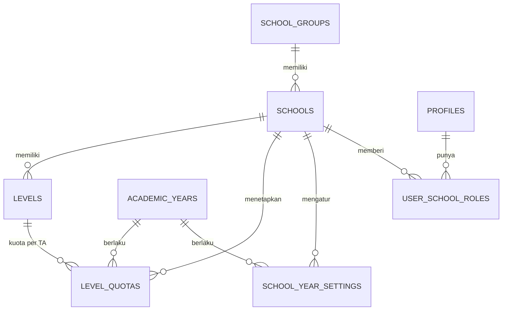
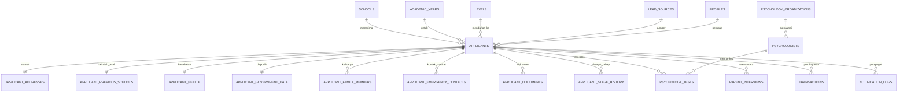
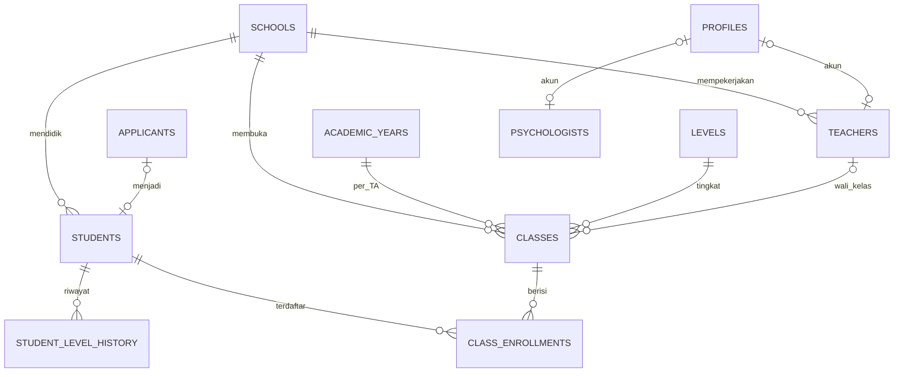

# 11 · Database Relationships

## ERD: master & akses

## ERD: pendaftar

## ERD: akademik

## Kardinalitas & integritas

| Relasi | Kardinalitas | FK on delete | Catatan |
|---|---|---|---|
| school_groups → schools | 1:N | restrict | Grup menentukan brand |
| schools → levels | 1:N | cascade | |
| levels + academic_years → level_quotas | 1:1 per (TA, level) | cascade | `unique(academic_year_id, level_id)` |
| profiles → user_school_roles | 1:N | cascade | Banyak role per sekolah diizinkan |
| schools → applicants | 1:N | restrict | Tidak boleh hapus sekolah yang punya data |
| applicants → tabel 1:1 (alamat, sekolah asal, kesehatan, pemerintah) | 1:1 | cascade | PK = `applicant_id` |
| applicants → family_members | 1:N, maks 1 per relasi | cascade | `unique(applicant_id, relation)` |
| applicants → documents | 1:N, maks 1 per jenis | cascade | Hapus baris wajib diikuti hapus objek Storage (trigger/Edge Function) |
| applicants → stage_history | 1:N | cascade | Append-only |
| applicants → psychology_tests | 1:N | cascade | Hasil terbaru dipakai di detail |
| applicants → transactions | 1:N | set null | Transaksi keuangan tetap disimpan |
| applicants → students | 1:0..1 | set null | Siswa bisa berasal dari luar sistem PSB |
| teachers → classes (wali) | 1:N | set null | Satu guru boleh wali beberapa kelas lintas TA (FAKTA data Odoo) |
| students + academic_years → class_enrollments | 1 kelas per siswa per TA | cascade | `unique(student_id, academic_year_id)` |
| psychologists → psychology_tests | 1:N | restrict | Psikolog lintas sekolah |

## Konsistensi lintas tabel (wajib ditegakkan)

| Aturan | Mekanisme |
|---|---|
| `applicants.level_id` harus milik `applicants.school_id` | Trigger `check_level_school` |
| `classes.level_id` & `homeroom_teacher_id` harus milik `classes.school_id` | Trigger |
| `psychology_tests.school_id` = `applicants.school_id` | Trigger mengisi otomatis dari applicant |
| `applicant_documents.school_id` = `applicants.school_id` | Trigger mengisi otomatis |
| `class_enrollments.academic_year_id` = `classes.academic_year_id` | Trigger |
