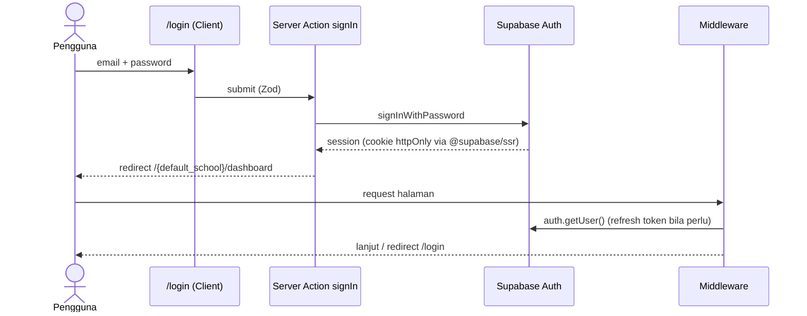

# 12 · Supabase Authentication

> **FAKTA:** prototipe tidak punya halaman login. Yang ada hanya profil "Admin Admission" dan state "Tanpa hak akses". Seluruh alur di bawah adalah **REKOMENDASI**; desain halaman auth berstatus `DECISION REQUIRED`.

## 1. Metode

| Metode | MVP | Catatan |
|---|---|---|
| Email + password | ✅ | Akun internal sekolah |
| Undangan (invite) oleh admin | ✅ | Tanpa registrasi publik |
| Registrasi publik | ❌ | **Dimatikan** (`Enable signups = off`) |
| Magic link / OTP | Opsional | `DECISION REQUIRED` |
| Google Workspace SSO | Opsional | Bila sekolah memakai domain Google (`OPEN QUESTION` Q-14) |

## 2. Alur



| Alur | Implementasi |
|---|---|
| **Login** | Server Action `signIn` → `supabase.auth.signInWithPassword`. Pesan error generik: "Email atau password salah" |
| **Logout** | Server Action `signOut` → `supabase.auth.signOut()` → redirect `/login` |
| **Lupa password** | `resetPasswordForEmail(email, { redirectTo: <origin>/auth/callback?next=/reset-password })`. Selalu tampilkan "Jika email terdaftar, tautan telah dikirim" |
| **Reset password** | `/reset-password` (sesi recovery) → `updateUser({ password })` |
| **Undangan** | Admin memanggil Server Action `inviteUser` → Edge Function memakai service role `auth.admin.inviteUserByEmail` + insert `profiles` & `user_school_roles` |
| **Callback** | `app/auth/callback/route.ts`: `exchangeCodeForSession(code)` lalu redirect ke `next` (hanya path internal) |
| **Profil** | Trigger `on auth.users insert` → buat `profiles` (nama dari metadata undangan) |

## 3. Session management

| Aspek | Keputusan |
|---|---|
| Penyimpanan | Cookie httpOnly, Secure, SameSite=Lax via `@supabase/ssr` |
| Refresh | Middleware memanggil `getUser()` di setiap request ke route aplikasi |
| Verifikasi di server | Selalu `getUser()` (memvalidasi JWT ke Supabase), **bukan** `getSession()` untuk keputusan otorisasi |
| Durasi | JWT 1 jam, refresh token rotasi. `DECISION REQUIRED`: idle timeout (usul 8 jam) |
| `last_seen_at` | Diperbarui maksimal 1×/5 menit untuk status "Online" guru (bila Q-11 disetujui) |

## 4. Middleware / proxy

```ts
// middleware.ts (sketsa, sesuaikan dengan versi @supabase/ssr yang terpasang)
export const config = { matcher: ['/((?!_next/static|_next/image|favicon.ico|assets/).*)'] };
// 1. createServerClient dengan cookie request/response
// 2. const { data: { user } } = await supabase.auth.getUser()
// 3. Route publik: /login, /forgot-password, /reset-password, /auth/callback
// 4. Tanpa user di route privat → redirect /login?next=<path>
// 5. Dengan user di /login → redirect /
```

Middleware **hanya** memeriksa autentikasi. Otorisasi sekolah dilakukan di `app/(app)/[school]/layout.tsx` dan RLS.

## 5. Protected routes & guard sekolah

| Route | Guard |
|---|---|
| `/(auth)/*` | Publik |
| `/` | Login wajib → redirect ke `profiles.default_school_id` atau sekolah pertama yang diizinkan |
| `/[school]/*` | Login wajib + `has_school_role(school.id)`; jika tidak punya → render `NoAccessState` (status 403) |
| `/[school]/settings` | `school_admin` / super admin |
| `/admin/*` | `is_super_admin` |

```ts
// app/(app)/[school]/layout.tsx (sketsa)
const school = await getSchoolByCode(params.school)        // RLS: hanya sekolah yang bisa dibaca
if (!school) return <NoAccessState />                      // tidak ada akses atau tidak ada sekolah
const roles = await getMyRoles(school.id)
```
