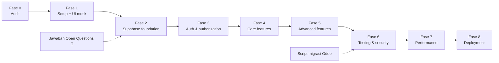

# 22 · Implementation Roadmap

---

## Fase 0 · Project audit ✅

| | |
|---|---|
| **Objectives** | Memahami UI/UX & kebutuhan |
| **Tasks** | Audit prototipe, inventaris, dokumentasi ini |
| **Deliverables** | `docs/`, `CLAUDE.md`, `AGENTS.md`, `README.md` |
| **Acceptance** | Pemilik produk menyetujui dokumentasi; Open Questions 🔴 dijawab |
| **Testing** | Checklist validasi dokumentasi (CHANGELOG) |

## Fase 1 · Project setup + porting UI (mock)

| | |
|---|---|
| **Objectives** | Semua halaman tampil persis prototipe dengan data mock |
| **Dependencies** | Fase 0 |
| **Tasks** | 1) Next.js + TS strict + Tailwind + shadcn + Vitest/Playwright. 2) Token & tema brand ([04](04-UI-UX-SPECIFICATION.md)). 3) `lib/domain/*` + unit test U1–U12. 4) Shell (sidebar, switcher, top bar). 5) Komponen data bersama. 6) Semua halaman P1–P10 + mobile, memakai **adapter mock** dengan kontrak yang sama dengan `lib/data` |
| **Deliverables** | UI lengkap dengan mock, `/dev/tokens`, `/dev/components` |
| **Acceptance** | Visual sesuai prototipe (screenshot), keyboard-only bisa, axe bersih, unit domain ≥ 95% |
| **Testing** | Unit, komponen, E2E E2/E3/E6/E9/E10 dengan mock |

## Fase 2 · Supabase foundation

| | |
|---|---|
| **Objectives** | Skema, RLS, storage siap di lokal & staging |
| **Dependencies** | Fase 1, jawaban Q-01, Q-02, Q-03, Q-07, Q-13 (+ Q-20–Q-23 bila disetujui) |
| **Tasks** | `supabase init`; migration enum + 30 tabel + trigger + view + RPC ([10](10-DATABASE-SCHEMA.md)); RLS ([13](13-ROW-LEVEL-SECURITY.md)); bucket + policy ([16](16-FILE-STORAGE.md)); seed dev (9 sekolah, level, TA, data contoh); generate types |
| **Deliverables** | `supabase/migrations/*`, `seed.sql`, `database.types.ts` |
| **Acceptance** | `supabase db reset` bersih; pgTAP constraint & view lulus; view turunan = hasil `lib/domain` untuk dataset yang sama |
| **Testing** | pgTAP struktur + logika turunan |

## Fase 3 · Authentication & authorization

| | |
|---|---|
| **Objectives** | Login aman & akses per sekolah |
| **Dependencies** | Fase 2, desain halaman login (`DECISION REQUIRED`), Q-04 |
| **Tasks** | `@supabase/ssr` client server/browser, middleware, halaman login/lupa/reset, callback, guard `[school]/layout`, `getAccessibleSchools`, NoAccess, Edge Function `invite-user`, helper `requireSchoolRole` |
| **Deliverables** | Auth lengkap, dropdown sekolah dari DB |
| **Acceptance** | R1–R10 lulus; E1 lulus; signup publik mati |
| **Testing** | pgTAP RLS, E2E auth |

## Fase 4 · Core features

| | |
|---|---|
| **Objectives** | Ganti mock dengan data Supabase untuk alur inti |
| **Dependencies** | Fase 3 |
| **Tasks** | `lib/data` + RPC dashboard; Pendaftar (list, count, filter, sort, paging); `moveApplicantStage` (+ optimistic, kanban); detail 7 tab (baca); upload/lihat dokumen; export Excel pendaftar |
| **Deliverables** | Dashboard, Pendaftar, Detail berfungsi penuh (baca + ubah tahap + dokumen) |
| **Acceptance** | US-01, US-02, US-03, US-04 lulus; E3–E7 lulus pada Supabase lokal |
| **Testing** | Integrasi action, E2E |

## Fase 5 · Advanced features

| | |
|---|---|
| **Objectives** | Modul pendukung & fitur yang belum didesain |
| **Dependencies** | Fase 4, desain form (`DECISION REQUIRED`), Q-05 provider WA/email |
| **Tasks** | Transaksi (+ rekonsiliasi), Psikotes (+ panel, input hasil), Psikolog, Kelas, Siswa, Guru; edit field detail; pendaftar baru; jadwal psikotes/wawancara; keputusan penerimaan; kirim WA/email (Edge Function + log); pengaturan sekolah; manajemen pengguna |
| **Deliverables** | Semua FR selesai |
| **Acceptance** | US-05, US-06; E8, E9 |
| **Testing** | Integrasi, E2E, RLS modul baru |

## Fase 6 · Testing, security & migrasi data

| | |
|---|---|
| **Objectives** | Siap UAT dengan data asli |
| **Dependencies** | Fase 5, akses Odoo (Q-02) |
| **Tasks** | Script `scripts/migrate-from-odoo` (idempoten, dry-run, laporan selisih: jumlah per tahap/TA, headcount kelas, file); audit keamanan ([19](19-SECURITY-REQUIREMENTS.md)); axe semua route; UAT |
| **Deliverables** | Data staging = Odoo; laporan migrasi; laporan UAT |
| **Acceptance** | Jumlah per tahap & TA per sekolah = Odoo; 0 temuan kritis |
| **Testing** | Rekonsiliasi migrasi, ZAP baseline (opsional) |

## Fase 7 · Performance optimization

| | |
|---|---|
| **Objectives** | Memenuhi target [20](20-PERFORMANCE-REQUIREMENTS.md) |
| **Dependencies** | Fase 6 (data volume asli) |
| **Tasks** | `explain analyze` query utama, index tambahan, lazy load, ukur Web Vitals |
| **Acceptance** | Semua target p75 tercapai di staging |

## Fase 8 · Deployment

| | |
|---|---|
| **Objectives** | Go-live |
| **Dependencies** | Fase 7, persetujuan pemilik produk |
| **Tasks** | Proyek Supabase production, migration production (**oleh manusia**), Vercel production, domain, migrasi data final (freeze Odoo), monitoring, rencana rollback ([23](23-DEPLOYMENT-AND-DEVOPS.md)) |
| **Acceptance** | Smoke test E1–E10 di production; Odoo read-only |
