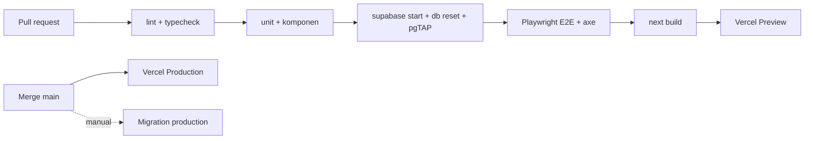

# 23 · Deployment & DevOps

## 1. Environment

| Env | Next.js | Supabase | Data |
|---|---|---|---|
| Local | `pnpm dev` | `supabase start` (Docker) | `seed.sql` (contoh) |
| Preview | Vercel Preview per PR | Proyek **staging** (atau Supabase Branching, `DECISION REQUIRED`) | Seed / snapshot staging |
| Staging | Vercel (branch `staging`) | Proyek staging | Hasil migrasi Odoo (anonimisasi opsional) |
| Production | Vercel (branch `main`) | Proyek production | Data asli |

## 2. Local development

```bash
pnpm install
supabase start                 # Postgres, Auth, Storage lokal
supabase db reset              # migration + seed
supabase gen types typescript --local > lib/supabase/database.types.ts
cp .env.example .env.local     # isi URL & anon key lokal dari `supabase status`
pnpm dev
```

## 3. Supabase configuration

| Pengaturan | Nilai |
|---|---|
| Auth: signups | **Off** |
| Auth: Site URL / Redirect URLs | Domain production + staging + `http://localhost:3000` |
| Auth: email templates | Bahasa Indonesia (undangan, reset) |
| Auth: password min | 12 |
| Extensions | `pg_trgm`, `pgcrypto` |
| Storage | 4 bucket ([16](16-FILE-STORAGE.md)) |
| Backups | PITR production (`DECISION REQUIRED` paket) |
| Region | Singapore (ap-southeast-1), paling dekat ke Indonesia (REKOMENDASI) |

## 4. Migration deployment

- Semua perubahan skema = file di `supabase/migrations/` (dibuat via `supabase migration new`).
- **Dilarang** mengubah skema dari dashboard di staging/production.
- Staging: `supabase db push` dari CI setelah merge ke `staging`.
- Production: dijalankan **manual oleh manusia** setelah review (`supabase db push --linked` ke proyek production). Claude Code tidak menjalankan ini.
- Migration harus aman untuk data yang sudah ada (tambah kolom nullable, backfill, baru kemudian `not null`).

## 5. CI/CD (GitHub Actions)



| Job | Gagal bila |
|---|---|
| lint, typecheck | error apa pun |
| test | test gagal / coverage domain < 95% |
| db | migration error / pgTAP gagal |
| e2e | skenario E gagal / axe serious |
| audit | `pnpm audit --prod` high/critical |

## 6. Rollback

| Komponen | Cara |
|---|---|
| Next.js | Vercel "Instant Rollback" ke deployment sebelumnya |
| Migration | Setiap migration punya rencana down tertulis di PR; untuk perubahan destruktif gunakan pola expand → migrate → contract |
| Data | PITR Supabase ke titik sebelum insiden |
| Go-live | Odoo tetap bisa dipakai (read-only) sampai stabil 2 minggu (REKOMENDASI) |
